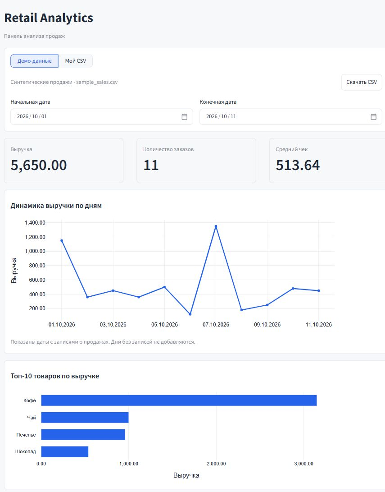

# Retail Analytics

**Интерактивный дашборд для анализа продаж интернет-магазина**, разработанный на Python и Streamlit с использованием OpenAI Codex.

Приложение позволяет анализировать продажи по загруженному CSV-файлу или использовать встроенные демонстрационные данные.

**[Открыть приложение](https://olyshon-retail-analytics.streamlit.app/)**

## Интерфейс приложения



Демонстрационные данные. Показатели пересчитываются при изменении периода или загрузке CSV.

## Возможности

- **Ключевые показатели:** выручка, количество уникальных заказов и средний чек.
- **Динамика продаж:** интерактивный график дневной выручки.
- **Топ-10 товаров:** рейтинг товаров по выручке.
- **Фильтрация по датам:** автоматический пересчёт всех показателей и графиков за выбранный период.
- **Загрузка CSV:** проверка структуры и корректности данных с понятными сообщениями об ошибках.
- **Деморежим:** просмотр аналитики без загрузки файла и скачивание примера CSV.

## Технологии

**Python · Streamlit · pandas · Plotly · pytest · Git**

Для точных денежных расчётов используется `Decimal`. Бизнес-логика, обработка данных и визуализация разделены на отдельные модули.

## Формат данных

Приложение принимает CSV в кодировке UTF-8 со следующими столбцами:

| Столбец | Описание |
|---|---|
| `order_id` | Идентификатор заказа |
| `order_date` | Дата заказа (`YYYY-MM-DD`) |
| `product_name` | Наименование товара |
| `quantity` | Количество |
| `unit_price` | Цена за единицу |

Одна строка соответствует товарной позиции. Один заказ может содержать несколько позиций.

Выручка рассчитывается как сумма `quantity × unit_price` по всем позициям с округлением до двух знаков. Средний чек — выручка, делённая на количество уникальных заказов. Возвраты и скидки в текущей версии не учитываются.

## Локальный запуск

Требуется Python 3.12.

```powershell
git clone https://github.com/Olyshon/retail-analytics.git
cd retail-analytics
python -m venv .venv
.\.venv\Scripts\python.exe -m pip install -r requirements.txt
.\.venv\Scripts\python.exe -m streamlit run app.py
```

Приложение откроется по адресу `http://localhost:8501`.

**Запуск тестов:**

```powershell
.\.venv\Scripts\python.exe -m pytest -q
```

## О разработке

Проект создан в процессе освоения агентной разработки с **OpenAI Codex**.

Работа включала постановку функциональных требований, проектирование бизнес-логики, итеративную разработку, автоматическое и ручное тестирование, код-ревью, исправление ошибок и публикацию приложения через GitHub и Streamlit Community Cloud.
